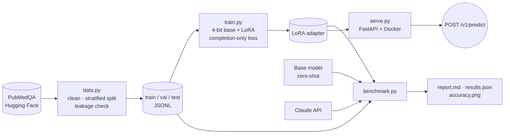

<div align="center">

# 🧬 PubMedQA-QLoRA

### Fine-tuning a small LLM for biomedical question answering, benchmarked against its base model and a frontier API model

[](https://github.com/abdulahadwork-code/Fine-tuned-LLM-with-LoRA-benchmarking/actions/workflows/ci.yml)


[](LICENSE)

</div>

---

## 📌 Overview

Large API models are accurate, but every request costs money, sends data to a third party and adds
network latency. That matters in **healthcare**. Can a **1.5-billion-parameter open model**,
fine-tuned on one consumer GPU, close the gap?

This project:

1. **Fine-tunes** [`Qwen2.5-1.5B-Instruct`](https://huggingface.co/Qwen/Qwen2.5-1.5B-Instruct) with **QLoRA** (4-bit NF4 + LoRA adapters) on **[PubMedQA](https://pubmedqa.github.io/)**. Given a research question and a PubMed abstract, the model answers **yes / no / maybe** and gives a rationale.
2. **Benchmarks** three systems on the same 500 held-out, expert-labelled questions:
   - the **base model** (zero-shot)
   - the **fine-tuned model** (QLoRA)
   - a **frontier API model** (Claude, via the official Anthropic SDK)
3. **Reports** accuracy, macro-F1, 95% bootstrap confidence intervals, McNemar significance tests, latency and cost.
4. **Serves** the fine-tuned model through a production **FastAPI** service, packaged in **Docker**.

```text
Input   Context:  "We studied 1,200 patients ... mortality was significantly lower in the treated group ..."
        Question: "Does early statin therapy reduce mortality after acute MI?"

Output  Answer: yes
        Rationale: Early statin therapy was associated with significantly lower mortality ...
```

---

## 🏗️ Architecture



---

## ✨ Key features

| Area | What's implemented |
|---|---|
| **Data** | Stratified, seeded splits; de-duplication by PubMed ID; automatic leakage check; splits saved once for reproducibility |
| **Training** | QLoRA (NF4, double quantisation, paged AdamW 8-bit), LoRA on all linear layers, **prompt masking** (loss only on the answer), gradient checkpointing, early stopping |
| **Evaluation** | Accuracy, macro-F1, per-class P/R/F1, confusion matrices, **bootstrap 95% CI**, **exact McNemar test**, latency p50/p95, API cost |
| **Robustness** | Resumable benchmark (cached predictions, failed calls retried), refusals and errors counted, not dropped; robust answer parsing |
| **Serving** | FastAPI with `/health`, `/ready`, `/v1/predict`; input validation, optional API-key auth, request IDs, concurrency limit; adapter merge for vLLM/TGI |
| **Engineering** | Typed YAML config (pydantic) + CLI overrides, `domain-llm` CLI, 31 unit tests (no GPU needed), Ruff, GitHub Actions CI, Docker, VS Code launch configs |

---

## 📊 Results

> **Status:** the full GPU run is pending. Train with `configs/qlora.yaml` and paste the table from
> `outputs/benchmark/report.md` here.

| System | Accuracy (95% CI) | Macro-F1 | p50 latency | Cost / 500 Qs |
|---|---|---|---|---|
| Qwen2.5-1.5B (zero-shot) | – | – | – | $0 |
| Qwen2.5-1.5B + QLoRA | – | – | – | $0 |
| Claude (API) | – | – | – | – |

Reference points: majority class ≈ 55%, single human annotator ≈ 78% ([Jin et al., 2019](https://arxiv.org/abs/1909.06146)).

**Pipeline check (CPU smoke test, 135M model, 10 training steps):** the share of answers in the required
format rose from **12.5% → 87.5%**. This confirms the training loop works; accuracy at this scale is not meaningful.

---

## 🔬 Method

### Dataset: PubMedQA

| Subset | Size | Labels | Used for |
|---|---|---|---|
| `pqa_labeled` | 1,000 | expert yes / no / maybe | **400 train · 100 val · 500 test** (stratified) |
| `pqa_artificial` | 211k | heuristic yes / no | +10,000 sampled training examples |

### Training configuration

| Setting | Value |
|---|---|
| Base model | `Qwen/Qwen2.5-1.5B-Instruct` |
| Quantisation | 4-bit NF4, double quant, bf16 compute |
| LoRA | r = 16, α = 32, dropout = 0.05, all linear layers (~1% trainable) |
| Optimiser | paged AdamW 8-bit, LR 2e-4, cosine, 3% warmup |
| Batch | 4 × 4 gradient accumulation = 16 effective |
| Epochs | 2, early stopping on val loss (patience 3) |
| Max sequence | 1,024 tokens |
| Hardware | one 12–16 GB GPU (e.g. a free Colab T4), about 1–2 h |

### Fair comparison

All three systems get the **same system prompt, context truncation, test set and answer parser**. Local
models use greedy decoding. Unparseable outputs and API errors count as **incorrect**.

---

## 🚀 Quick start

### 1. Install

```bash
git clone https://github.com/abdulahadwork-code/Fine-tuned-LLM-with-LoRA-benchmarking.git
cd Fine-tuned-LLM-with-LoRA-benchmarking
python -m venv .venv
# Windows: .venv\Scripts\activate   |   macOS/Linux: source .venv/bin/activate
pip install torch --index-url https://download.pytorch.org/whl/cpu   # or the CUDA build from pytorch.org
pip install -e ".[all,dev]"
cp .env.example .env   # add ANTHROPIC_API_KEY for the API baseline
```

### 2. Verify everything works (CPU, about 10 minutes)

```bash
make smoke
# or step by step:
domain-llm prepare-data -c configs/smoke.yaml
domain-llm train        -c configs/smoke.yaml
domain-llm benchmark    -c configs/smoke.yaml
```

### 3. Full experiment (GPU)

```bash
domain-llm prepare-data -c configs/qlora.yaml
domain-llm train        -c configs/qlora.yaml
domain-llm benchmark    -c configs/qlora.yaml
```

Override any setting from the CLI:

```bash
domain-llm train -c configs/qlora.yaml -s lora.r=32 -s train.learning_rate=1e-4
domain-llm benchmark -c configs/qlora.yaml -s "benchmark.systems=[base, finetuned]"
```

<details>
<summary><b>Run on Google Colab (free GPU)</b></summary>

```python
!git clone https://github.com/abdulahadwork-code/Fine-tuned-LLM-with-LoRA-benchmarking.git
%cd Fine-tuned-LLM-with-LoRA-benchmarking
!pip install -e ".[all]"
!domain-llm prepare-data -c configs/qlora.yaml
!domain-llm train -c configs/qlora.yaml
!domain-llm benchmark -c configs/qlora.yaml -s "benchmark.systems=[base, finetuned]"
```
If you run out of memory, add `-s train.per_device_train_batch_size=2 -s train.gradient_accumulation_steps=8`.
</details>

<details>
<summary><b>Run in VS Code</b></summary>

1. Open the folder in VS Code and install the recommended extensions.
2. Create the `.venv` and install as above, then choose **Python: Select Interpreter → .venv**.
3. Open **Run and Debug** (`Ctrl+Shift+D`) and run the ready-made configurations in order: *Prepare data → Train → Benchmark → Serve API*.
4. Tests appear in the **Testing** sidebar.
</details>

---

## 🌐 Serving

```bash
domain-llm serve -c configs/qlora.yaml        # Swagger UI at http://localhost:8000/docs
```

| Endpoint | Description |
|---|---|
| `GET /health` | Liveness probe |
| `GET /ready` | Readiness probe (503 until the model is loaded) |
| `POST /v1/predict` | Answer a question from context passages |

```bash
curl -X POST http://localhost:8000/v1/predict \
  -H "Content-Type: application/json" \
  -d '{"question": "Does early statin therapy reduce mortality after acute MI?",
       "contexts": ["We studied 1,200 patients ... mortality was significantly lower ..."]}'
```

Example response (illustrative):

```json
{
  "answer": "yes",
  "rationale": "Early statin therapy was associated with significantly lower mortality ...",
  "raw_output": "Answer: yes\nRationale: ...",
  "latency_ms": 182.4,
  "model": "Qwen/Qwen2.5-1.5B-Instruct+outputs/qlora/adapter",
  "request_id": "3f9c..."
}
```

Set `DOMAIN_LLM_API_KEY` to require an `X-API-Key` header.

**Docker**

```bash
docker build -t pubmedqa-qlora .
docker run --gpus all -p 8000:8000 -v "$PWD/outputs:/app/outputs" pubmedqa-qlora
```

**Merged model** (for vLLM / TGI or deployment without PEFT):

```bash
domain-llm merge -c configs/qlora.yaml --out-dir outputs/merged
DOMAIN_LLM_MERGED_MODEL=outputs/merged domain-llm serve
```

---

## 📁 Project structure

```text
├── configs/
│   ├── qlora.yaml          # main experiment (GPU)
│   └── smoke.yaml          # tiny end-to-end check (CPU)
├── src/domain_llm/
│   ├── config.py           # typed config + CLI overrides
│   ├── data.py             # loading, stratified splits, leakage check
│   ├── prompts.py          # shared prompt template + answer parser
│   ├── modeling.py         # model loading, 4/8-bit quantisation
│   ├── train.py            # QLoRA SFT with completion-only loss
│   ├── inference.py        # batched generation, adapter merge
│   ├── api_client.py       # Claude baseline (Anthropic SDK)
│   ├── benchmark.py        # resumable 3-way benchmark
│   ├── metrics.py          # accuracy, F1, bootstrap CI, McNemar
│   ├── report.py           # Markdown report + chart
│   ├── serve.py            # FastAPI service
│   └── cli.py              # `domain-llm` command
├── tests/                  # 31 tests, no GPU / network required
├── .github/workflows/ci.yml
├── Dockerfile
└── Makefile
```

---

## 🧪 Testing

```bash
pytest             # 31 tests: parsing, splits, leakage, metrics, config, benchmark, API client, server
ruff check src tests
```

CI runs lint and tests on Python 3.10 and 3.12 for every push and pull request.

---

## 🛠️ Tech stack

**Deep learning:** PyTorch · Hugging Face Transformers · PEFT (LoRA) · bitsandbytes (4-bit) · Accelerate · Datasets
**NLP:** instruction tuning · chat templates · completion-only SFT · constrained answer parsing
**Evaluation:** bootstrap CIs · McNemar test · macro-F1
**API baseline:** Anthropic Python SDK
**Serving and MLOps:** FastAPI · Uvicorn · Docker · GitHub Actions · pytest · Ruff · Pydantic · Typer

---

## 🗺️ Roadmap

- [ ] Publish full GPU results
- [ ] LoRA rank ablation (r = 4 / 8 / 16 / 64) and QLoRA vs LoRA comparison
- [ ] Few-shot base-model baseline
- [ ] Class-balanced training (the artificial subset has no "maybe")
- [ ] Rationale quality evaluation (ROUGE / LLM-as-judge)
- [ ] vLLM serving benchmark

---

## ⚠️ Disclaimer

Research and educational project. **Not a medical device.** Do not use it for clinical decisions.

## 📚 References

- Jin et al. (2019). *PubMedQA: A Dataset for Biomedical Research Question Answering.* [arXiv:1909.06146](https://arxiv.org/abs/1909.06146)
- Hu et al. (2021). *LoRA: Low-Rank Adaptation of Large Language Models.* [arXiv:2106.09685](https://arxiv.org/abs/2106.09685)
- Dettmers et al. (2023). *QLoRA: Efficient Finetuning of Quantized LLMs.* [arXiv:2305.14314](https://arxiv.org/abs/2305.14314)

## 👤 Author

**Abdul Ahad** · [GitHub](https://github.com/abdulahadwork-code)

Licensed under the [MIT License](LICENSE).
